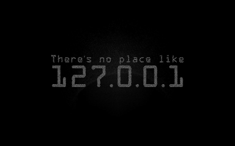

### Turning “what if ?” into “it works.” ヅ

*Building Practical Projects while learning Web Development, Backend Technologies, DSA & Applied AI.*

## Technology Stack & Creative Tools

  
  
  
  
  
  
  
  
  
  
  

## Connect With Me

<!-- Replace the placeholder URLs below with your links, and remove any badges you don't want to use. -->

  
   
  
 

